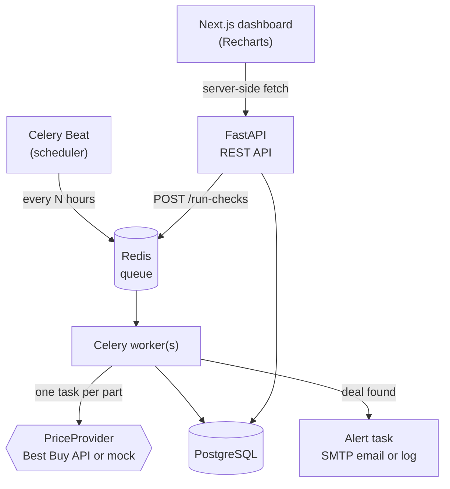

# PartWatch

[](https://github.com/pepsi-boy/partwatch/actions/workflows/ci.yml)

**Live demo:** [dashboard](https://partwatch-dashboard.onrender.com) · [API docs](https://partwatch-api.onrender.com/docs) (free tier: the first visit after a quiet spell takes up to a minute while the services wake up)

A self-running PC parts price tracker. On a schedule it fetches the current Best Buy price of every tracked part, builds a price history, and flags real deals: prices well below the part's 30-day average, or below a target price you set. Every deal triggers an alert.

I build and sell custom PCs, and I wanted to know when parts are actually worth buying without checking prices by hand.

> **Demo mode:** until a Best Buy API key is added, PartWatch runs on a mock Best Buy provider. It returns data in the real Products API format, with prices that drift and go on sale so deals actually trigger. The starter parts use **placeholder SKUs** (`000000x`). Set `BESTBUY_API_KEY` and replace the SKUs in [`backend/app/seed_data.py`](backend/app/seed_data.py) (or add parts through the API) to switch to real prices. No code changes needed.

## What it does

- **Tracks parts** by Best Buy SKU. Add, pause, retarget, or remove them through the API.
- **Checks prices on a schedule** (every 3 hours by default) and stores every snapshot.
- **Detects deals** with two rules:
  - at least 10% below the 30-day average, once a part has at least 5 snapshots (so new parts can't false-alarm), or
  - at or below the part's target price, if you set one.
- **Alerts once per deal.** It doesn't re-alert at the same price. It alerts again if the price drops further, or after the price recovers and drops again.
- **Shows it all** on a Next.js dashboard: tracked parts with deal badges, a price history chart per part, a deals feed, and a system status page. The API also has interactive docs (`/docs`).

## Architecture



- **Fan-out:** the scheduled `check_all_prices` task queues one `check_part_price` task per part. One failing SKU can't break the run, and more workers means more parallelism.
- **Provider interface:** tasks fetch prices through `PriceProvider`. The real Best Buy client is used when `BESTBUY_API_KEY` is set, and the mock otherwise. Both go through the same response parser.
- **Dashboard:** Next.js server components fetch from the API on the server, so the browser never calls the API directly (no CORS, and the API address isn't exposed to the browser).
- **Pure deal logic:** the rules live in [`services/deals.py`](backend/app/services/deals.py), with no database or I/O, so every edge case is unit tested.

Design decisions and tradeoffs are written up in [`docs/design.md`](docs/design.md).

### Reliability

| Concern | How it's handled |
|---|---|
| Slow or hung API | Timeout on every call (10s read, 5s connect) |
| Rate limits, outages | Retries with exponential backoff and jitter on timeouts, 429, 5xx, and over-quota 403. Permanent errors (404, bad key) fail fast |
| Best Buy limit (5 calls/sec) | Celery rate limit of 4/sec per worker |
| Duplicate runs, retries | Idempotent: unique `(part, check window)` snapshot, unique deal per snapshot, `alerted_at` guard on alerts |
| Worker crash mid-task | Late acks, so an unfinished task goes back on the queue |
| Email failure | Alert is a separate task with its own retries. The deal is saved first and never lost |
| Visibility | `job_runs` row per run (success / partial / failed), JSON logs per task, `/status`, `/health` |

## Tech stack

**Backend:** FastAPI · SQLAlchemy + Alembic · PostgreSQL · Celery + Celery Beat · Redis · httpx · pytest · ruff
**Frontend:** Next.js (App Router, TypeScript) · Recharts
**Ops:** Docker Compose · GitHub Actions · Render

## Run locally

Requires Docker.

```bash
git clone https://github.com/pepsi-boy/partwatch.git && cd partwatch
cp .env.example .env          # optional: set ADMIN_TOKEN to use the write endpoints
docker compose up --build     # api, worker, beat, postgres, redis, web

# In another terminal: add starter parts plus 30 days of mock history (demo mode)
docker compose exec api python -m app.seed --backfill-days 30
```

Then open:
- http://localhost:3000: dashboard (set `WEB_PORT` if 3000 is taken)
- http://localhost:8000/docs: interactive API docs
- http://localhost:8000: a minimal built-in status page, handy when the dashboard isn't running

Beat triggers a check every `CHECK_INTERVAL_HOURS`. To run one now:

```bash
docker compose exec api python -c "from app.tasks import check_all_prices; check_all_prices.delay()"
docker compose logs -f worker
```

### API

| Method | Path | Auth | Purpose |
|---|---|---|---|
| GET | `/health` | | Database and Redis connectivity (503 if degraded) |
| GET | `/parts` | | Parts with current price, 30-day average, deal badge |
| GET | `/parts/{id}` | | One part |
| GET | `/parts/{id}/prices?days=30` | | Price history |
| POST | `/parts` | admin | Track a SKU: `{"sku": "6521430", "category": "gpu", "target_price": 499.99}` |
| PATCH | `/parts/{id}` | admin | Pause/resume (`active`), rename, set or clear `target_price` |
| DELETE | `/parts/{id}` | admin | Stop tracking and delete history |
| GET | `/deals` | | Recent deals |
| GET | `/status` | | Recent runs, 7-day success rate, last successful run, errors |
| POST | `/run-checks` | admin | Queue a price check now |

Admin routes need `Authorization: Bearer $ADMIN_TOKEN`. If `ADMIN_TOKEN` is empty, they're disabled.

```bash
curl -X POST localhost:8000/parts \
  -H "Authorization: Bearer $ADMIN_TOKEN" -H "Content-Type: application/json" \
  -d '{"sku": "0000009", "category": "gpu", "target_price": 300}'
```

### Tests and lint

```bash
docker compose exec api pytest
docker compose exec api ruff check . && docker compose exec api ruff format --check .
cd frontend && npm run lint && npm run build && npm run typecheck
```

Tests run against a real PostgreSQL test database (migrated with Alembic, rolled back after each test). Best Buy responses and SMTP are always mocked, so the suite never calls the real API or sends email. CI runs the same suite on every push, with Postgres and Redis service containers, plus lint, build, and typecheck for the dashboard. Render deploys only after both jobs pass.

## Deployment (Render, free tier)

[`render.yaml`](render.yaml) defines the stack. Render auto-deploys from `main` **only after CI passes**.

Render's free tier doesn't include background workers or cron jobs, and it blocks outbound SMTP, so production runs a little differently from local:

| Piece | Local | Render free tier |
|---|---|---|
| Dashboard | `web` container | Free Node web service |
| API | `api` container | Free web service |
| Celery worker | `worker` container | Runs in the same container as the API ([`start.sh`](backend/start.sh)) |
| Scheduler | Celery Beat | GitHub Actions cron calls `POST /run-checks` every 3h ([workflow](.github/workflows/scheduled-checks.yml)) |
| Redis | `redis` container | Free Key Value (in-memory, not persisted) |
| PostgreSQL | `postgres` container | Shares the workspace's one free Postgres, in its own `partwatch` schema. **Free databases expire after 30 days** |
| Alerts | Email if SMTP is set, else logs | Logs and the deals page (SMTP is blocked) |

Setup:
1. In Render: **New → Blueprint**, pick this repo. Set `DATABASE_URL` to a Postgres internal connection string in the same region, and leave `BESTBUY_API_KEY` blank for demo mode.
2. Copy the service URL and the generated `ADMIN_TOKEN` (service → Environment).
3. In GitHub: **Settings → Secrets and variables → Actions**. Add the variable `PARTWATCH_URL` and the secret `PARTWATCH_ADMIN_TOKEN`.

## Project layout

```
backend/
  app/
    main.py            FastAPI app
    api/               route handlers (parts, deals, status, health, admin)
    services/
      bestbuy.py       Best Buy client + response parser
      providers.py     PriceProvider interface + mock provider
      deals.py         pure deal rules
      deal_finder.py   deal detection against the database
      alerts.py        SMTP / log alert senders
      snapshots.py     idempotent snapshot saves, check windows
      job_runs.py      run bookkeeping
    tasks.py           Celery tasks
    celery_app.py      Celery config + Beat schedule
    seed.py            starter parts + demo backfill
  alembic/             migrations
  tests/
frontend/
  app/                 Next.js pages: parts, part detail, deals, status
  components/          PriceChart (Recharts), badges, stat tiles
  lib/                 typed API client, formatting, chart helpers
docs/design.md         design decisions and tradeoffs
render.yaml            Render blueprint
```
